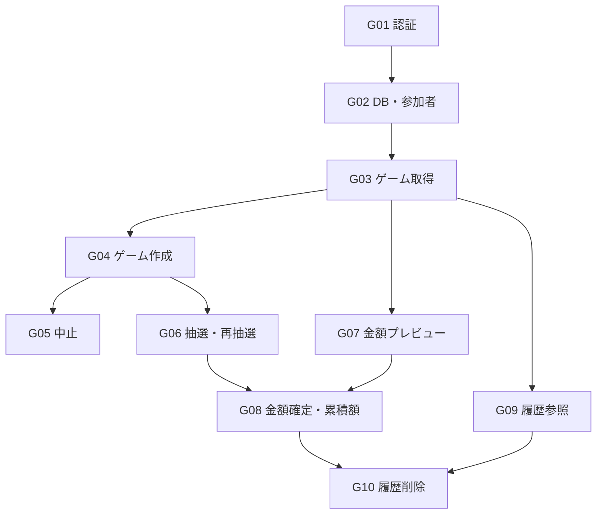

# バックエンド実装計画

作成日：2026年10月16日

目的：API実装をレビュー可能な大きさに分け、各チャットの作業範囲・ブランチ・依存関係・完了条件を共有する。本書とグループIDを指定すれば、そのグループの作業を依頼できる。

G01〜G10はすべてmainへマージ済み。履歴削除（A14）まで全14業務APIの実装を完了。各グループのPR状態と未実施の検証は末尾の進捗表に記録する。

## 参照資料

- [API定義](../spec/api-design.md)：HTTPメソッド、パス、要求・応答、共通エラー。
- [機能詳細](../spec/functional-design.md)：状態遷移、計算、重複操作、設計提案B01〜B10。
- [DB設計](../spec/database-design.md)：保存形式、パーティション、トランザクション。
- [インフラ設計](../spec/infrastructure.md)：Entra ID、権限、CORS、Azure接続。
- [バックエンドの起動手順](../backend/README.md)／[DB定義・反映手順](../database/README.md)。

本書は実装の分担・順序を決める。APIの契約や業務ルールは参照資料を正とし、差異や未決定事項が実装を左右する場合は、その点を明示して調整する。

## グループ一覧

原則として **1グループ＝1チャット＝1フィーチャーブランチ＝1 PR**。番号は推奨レビュー順であり、着手条件は「直接の依存先」列に従う。依存は原則、そのPRがmainへマージ済みであることを意味する。ブランチ名は下表の名前で固定する。

| ID・推奨順 | グループ | 対象API | フィーチャーブランチ | 直接の依存先 | 主なレビュー対象 |
|---|---|---|---|---|---|
| G01・1 | 認証・HTTP共通処理 | A01 利用権限確認 | `codex/backend-01-auth` | なし | 管理者認証、共通エラー、ヘルスチェックの除外 |
| G02・2 | DB接続・参加者取得 | A02 固定参加者 | `codex/backend-02-participants` | G01 | Cosmos接続、所有者識別、読取セッション、初期データ登録手順 |
| G03・3 | ゲーム状態の取得 | A04 未完了取得、A05 詳細 | `codex/backend-03-game-read` | G02 | ゲーム・現ラウンドの組立、再開、公開ETag |
| G04・4 | ゲーム作成・更新の共通処理 | A03 作成 | `codex/backend-04-game-create` | G03 | 二重開始防止、成功操作記録、再送、トランザクション |
| G05・5 | ゲーム中止 | A13 中止 | `codex/backend-05-game-cancel` | G04 | 状態制限、未完了ポインター解除、再送・競合 |
| G06・6 | サイコロ・再抽選 | A06 抽選、A07 次ラウンド | `codex/backend-06-dice` | G04 | 個別／一括、敗者判定、同点後の全員再抽選 |
| G07・7 | 金額プレビュー | A08 プレビュー | `codex/backend-07-payment-preview` | G03 | 金額入力検証、負担額・負け額の計算 |
| G08・8 | 金額確定・累積額 | A09 金額確定、A12 累積額 | `codex/backend-08-payment-save` | G06、G07 | 保存と加算の一括処理、二重加算防止、集計取得 |
| G09・9 | 履歴の参照 | A10 一覧、A15 履歴詳細 | `codex/backend-09-history-read` | G03 | ページング、当時名、削除済みの除外 |
| G10・10 | 履歴削除 | A14 削除 | `codex/backend-10-history-delete` | G08、G09 | 論理削除と減算の一括処理、二重削除防止 |

A11は廃止・欠番。実装対象に含めない。全14業務APIをそれぞれ一つのグループが担当する。

## 依存関係と進め方



最初はG01→G02→G03→G04を順番にレビュー・マージし、共通部分を安定させる。その後は同時進行を最大2チャット程度とする。例えばG05/G06、続いてG07/G09、最後にG08→G10の順で進められる。すべて番号順に一件ずつ進めてもよい。

G03はゲーム作成前、G07は抽選前、G09は金額保存前にも、保存形式に従うテスト用データで検証できる。これらの先行開発に、本番への仮データ投入や未実装APIの仮公開は必要ない。G08で作成→抽選→プレビュー→保存を通して確認し、G10で削除→履歴・累積額への反映まで確認する。

## 各グループの範囲と確認事項

### G01 認証・HTTP共通処理

API設計に従ってBearerトークンと管理者権限を検証し、A01を実装する。設定読取、共通エラー形式、requestId、no-store、CORSのAPI側の責務を整える。業務APIは認証必須を既定とし、匿名ヘルスチェックだけを明示的に除外する。

確認：本人の成功、トークン欠落・不正・期限切れの401、本人・スコープ等の権限不足403、認証失敗時にDB処理なし、OPTIONS、既存ヘルスチェックの維持。テストの認証差替えを本番の認証回避として組み込まない。

### G02 DB接続・参加者取得

Cosmosクライアントと設定、認証情報からのownerKey生成、必要な保存モデル、読取セッションの受渡しを整え、A02を実装する。roster/control/lossTotalsの初期登録用資材・手順もこのグループで用意する。API起動時にDBや初期データを自動作成しない。

確認：有効者のみ表示順で取得、別所有者にアクセス不可、未配置データの503、読取セッションの形式・上限。初期登録は3件の同時作成と既存データの上書き防止を確認する。実名ファイルはGitに含めず、実環境への登録実行は別途扱う。

### G03 ゲーム状態の取得

Game/Roundのモデルと応答組立を揃え、A04/A05を実装する。公開revisionからのETag、未完了ポインター、複数読取の整合性確認を扱う。

確認：未完了なしはnull、保存済み状態の復元、所有者外404、削除済み410、ポインター不整合・継続競合の503。認証・DB共通処理は前グループの実装を使用する。

### G04 ゲーム作成・更新の共通処理

A03を実装し、最初の更新APIに必要な範囲で、要求ハッシュ、成功操作記録、応答再生、条件付きバッチとエラー変換を整える。後続の抽選・保存・削除が使う共通処理とするが、後続APIの業務処理はここで作らない。

確認：参加者の検証、当時名・順序、game/round/control/commandの一括保存、同キー再送、キー使い回し、二重開始、コミット後応答断。汎用的な仕組みを先回りして広げず、必要な拡張は後続PRで行う。

### G05 ゲーム中止

A13を実装する。更新の共通処理を使い、中止状態への遷移とcontrol解除を一括保存する。

確認：未完了3状態のみ中止可、完了・中止済み拒否、出目保持、再送・版競合。保存API完成後の保存／中止の競合確認はG08で追加する。

### G06 サイコロ・再抽選

A06/A07を実装する。サーバー乱数、未抽選者だけの一括抽選、全員完了時の判定、同点後の新ラウンド作成を扱う。

確認：個別／一括混在でも既存値保持、未抽選中は未判定、最小一名／同点、再抽選は全員対象、敗者確定後の上書き拒否、旧ラウンド拒否、同時操作・再送。判定のテストでは乱数を制御できるようにする。

### G07 金額プレビュー

A08と、G08でも再利用する金額検証・計算処理を実装する。プレビューでDBを更新しない。

確認：13,800円・4人の例、負け額0円、小額、人数・金額の境界、小数／指数表記／文字列の拒否、状態制限、参照ゲームのETag。

### G08 金額確定・累積額

A09/A12を実装する。G07の計算を使用し、game確定、control解除、lossTotals加算、成功操作記録を一括保存する。累積額は保存Lだけを合算し、APIでは10進文字列で返す。

確認：再送で一回だけ加算、未完了・中止・削除済みは集計除外、現在名との対応、保存／中止の競合、失敗時の全件未更新。作成→抽選・再抽選→プレビュー→金額保存→累積取得を一連で検証する。

### G09 履歴の参照

A10/A15を実装する。負け額中心の一覧、境界カーソル、当時の名前、抽選記録を含まない詳細を扱う。

確認：並び順・同日時・ページ境界、空履歴、0円履歴、無効化／改名後の当時名、削除済みの非表示と410、詳細ETag。G03の保存モデルを再利用する。

### G10 履歴削除

A14を実装する。gameの論理削除、保存Lの減算、成功操作記録を一括保存し、別の未完了ゲームのcontrolは変更しない。

確認：同キー／別キー二重削除、0円・最終一件削除、別履歴削除や新ゲーム保存との競合、集計が負になる場合の停止、応答断後の再送。削除後の古い保存要求で復活・再加算しないこと、履歴と累積の整合性を一連で検証する。

## チャット・ブランチ・PRの運用

1. 担当グループと、依存先PRがmainにマージ済みであることを確認する。前提不足なら依存先の実装を複製せず、着手条件を報告する。
2. 最新のmainから表のブランチを作る。既存の同名ブランチ／PRがあれば内容と状態を確認して継続し、別作業を上書きしない。マージ済みブランチを再利用する必要がある場合は計画を更新する。
3. 複数チャットを並行させる場合は専用のGit worktreeを使用する。共通の作業ディレクトリでブランチを切り替えながら同時作業しない。
4. 対象API・必要な共通処理・テスト・関連資料を実装する。他グループのAPI、フロントエンド接続、インフラ配置を同じPRへ追加しない。共有ファイル変更が他作業に影響する場合は範囲を調整する。
5. 検証を終えたらコミット・プッシュし、main向けPRを一件作成する。PRにはグループID、対象API、依存PR、変更内容、検証結果、残る制約を記載する。レビュー後のマージはユーザーが判断する。

各グループは.NETビルドと、その変更に必要なテストを実施する。競合・冪等性・トランザクションは適切な統合検証を含める。実Cosmos互換の検証環境はG02で具体化し、本番データにテストを書き込まない。実行できない検証は未実施として理由を報告し、成功扱いにしない。

SDK／パッケージ・起動設定・公開DTOなどの共通変更は先行PRへ集約し、後続で変更が必要なら理由と影響範囲を明示する。グループが大きくなった場合は後続APIを抱え込まず、分割を本書へ反映する。

## 各チャットへの依頼文

次の文のグループIDを差し替えて使用する。

```text
plan/backend-implementation.md の G01 を担当してください。
本書の対象API・固定ブランチ名・依存関係・完了条件に従い、
依存先のmainへのマージ状況を確認したうえで実装してください。
並行作業時は専用worktreeを使用してください。
必要なテストと資料更新まで行い、コミット・プッシュしてmain向けPRを作成してください。
PRのマージとAzureへのデプロイは行わないでください。
```

PR作成後はこの文書末尾の進捗表へURLと状態を記録する。依存先の作業完了報告だけでマージ済みとは判断せず、実際のPR状態を確認する。

## 進捗

| グループ | 状態 | PR |
|---|---|---|
| G01 | mainへマージ済み | [#1](https://github.com/ChizenKomamiya/roll-and-pay/pull/1) |
| G02 | mainへマージ済み。エミュレーター統合2件は未実施 | [#2](https://github.com/ChizenKomamiya/roll-and-pay/pull/2) |
| G03 | mainへマージ済み。G03のエミュレーター統合2件は未実施 | [#3](https://github.com/ChizenKomamiya/roll-and-pay/pull/3) |
| G04 | mainへマージ済み。G04のエミュレーター統合3件は未実施 | [#5](https://github.com/ChizenKomamiya/roll-and-pay/pull/5) |
| G05 | mainへマージ済み。G05のエミュレーター統合3件は未実施 | [#7](https://github.com/ChizenKomamiya/roll-and-pay/pull/7) |
| G06 | mainへマージ済み。オフライン495件検証済み。G06のエミュレーター統合3件は未実施 | [#8](https://github.com/ChizenKomamiya/roll-and-pay/pull/8) |
| G07 | mainへマージ済み。オフライン280件検証済み。実Cosmos・実テナント疎通は未実施 | [#4](https://github.com/ChizenKomamiya/roll-and-pay/pull/4) |
| G08 | mainへマージ済み。オフライン594件検証済み。G08のエミュレーター統合4件は未実施 | [#14](https://github.com/ChizenKomamiya/roll-and-pay/pull/14) |
| G09 | mainへマージ済み。G09のエミュレーター統合2件は未実施 | [#6](https://github.com/ChizenKomamiya/roll-and-pay/pull/6) |
| G10 | mainへマージ済み。オフライン646件検証済み。G10のエミュレーター統合4件は未実施 | [#15](https://github.com/ChizenKomamiya/roll-and-pay/pull/15) |
