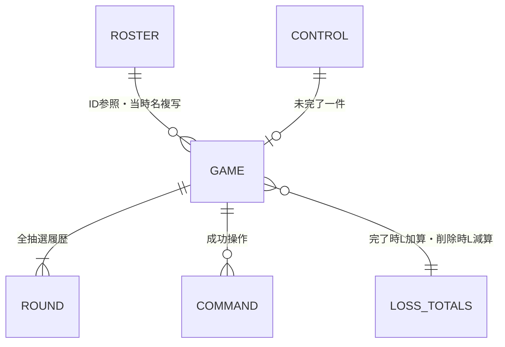

# サイコロは絶対 — データベース基本設計

作成日・公式資料確認日：2026年10月14日

状態：基本設計改訂稿。2026年10月14日のF14履歴削除と画面変更を反映。Cosmos DB for NoSQL Serverlessはインフラの合意事項。論理削除・保持・コンテナー構成・登録手順は設計提案。DB作成・実測・実装は未実施。

参照：[機能詳細](functional-design.md)／[API定義](api-design.md)／[インフラ](infrastructure.md)

2026年10月15日：[定義・反映スクリプト](../database/README.md)を追加。`database/container-definition.json`をDB名・コンテナー名・パーティション・インデックスの共通定義とし、DB単独のBicepとインフラ全体のBicepから参照する。実Azureへの反映・初期参加者投入は未実施。

## 1. 保存方式とパーティション

Databaseは`rollpay`、Containerは`app`一つ、Partition Keyは`/ownerKey`。ownerKeyはAPIが検証済みtidとoidから`<tid>:<oid>`として組み立てる。ブラウザーに設定させない。管理者のObject IDが変わる移行は別のデータ移行として扱う。

単一管理者・低頻度利用のため、本人の固定リスト・ゲーム・ラウンド・集計・操作記録を同じ論理パーティションに置く。これにより抽選と冪等性、金額と集計、未完了ポインターを同一コンテナー内のトランザクションで保存できる。[同一パーティションのTransactionalBatch](https://learn.microsoft.com/en-us/azure/cosmos-db/transactional-batch)

将来の多数利用者・大量履歴向けの構成ではない。論理パーティション容量・スループットに制約があるため、容量を監視し、分割が必要ならトランザクション・集計方式を再設計する。ゲームIDで分割する案は集計・未完了制御が別パーティションになるため初期版では採用しない。[パーティションの制約](https://learn.microsoft.com/en-us/azure/cosmos-db/partitioning-overview)

整合性はSession、TTLは無効。バックアップ・地域・接続権限はインフラ設計に従う。APIはManaged Identity、ブラウザーから直接DBへ接続しない。

## 2. ドキュメント一覧と関係

全ドキュメントに`id, ownerKey, type, schemaVersion`を持たせる。内部`_etag, _ts`等はCosmosが管理。idは同一ownerKey内で一意、アプリで決定的に生成する。Unique Keyは追加しない。

| type | id | 用途・主要項目 | 増え方 |
|---|---|---|---|
| roster | roster | participants、updatedAt | 本人につき1件 |
| control | control | activeGameId、updatedAt | 本人につき1件 |
| game | game:{UUID} | gameId、revision、状態、当時名、現ラウンド番号、敗者、会計、日時、deletedAt | ゲームごと1件 |
| round | round:{UUID}:{番号} | gameId、roundNumber、状態、全員の出目、最小値、同点者、日時 | ラウンドごと1件 |
| lossTotals | lossTotals | totals、updatedAt | 本人につき1件 |
| command | command:{冪等性UUID} | requestHash、gameId、操作、成功応答、日時 | 成功更新ごと1件 |



これは概念上の関係であり、DBの外部キーやJOIN制約ではない。APIの検証とトランザクションで整合性を守る。参加者の物理削除・ID再利用はしない。

## 3. スキーマ

### roster

```json
{
  "id":"roster","ownerKey":"<tid>:<oid>","type":"roster","schemaVersion":1,
  "participants":[
    {"participantId":"p001","displayName":"参加者A","sortOrder":1,"isActive":true},
    {"participantId":"p002","displayName":"参加者B","sortOrder":2,"isActive":true}
  ],
  "updatedAt":"2026-10-14T04:00:00Z"
}
```

最大100人（提案）、IDは英数字・ハイフン・アンダースコア1〜40文字、名前は1〜50文字。配列内ID重複禁止。sortOrderは非負整数。同順位はIDで並べる。無効者も過去集計に残す。選択可能なのはisActive=true。

### control

```json
{
  "id":"control","ownerKey":"<tid>:<oid>","type":"control","schemaVersion":1,
  "activeGameId":null,"updatedAt":"2026-10-14T04:00:00Z"
}
```

未完了がない場合null。新規開始で設定、完了または中止で解除。ゲームの状態と矛盾する場合503とし、運用修復する。自動解除すると二重ゲームを作るため行わない。

### game

```json
{
  "id":"game:7c56e8d0-1a58-4c45-8ef3-6505ad5c0a01",
  "ownerKey":"<tid>:<oid>","type":"game","schemaVersion":1,
  "gameId":"7c56e8d0-1a58-4c45-8ef3-6505ad5c0a01",
  "revision":1,"status":"rolling",
  "participants":[
    {"participantId":"p001","displayName":"参加者A","order":1},
    {"participantId":"p002","displayName":"参加者B","order":2}
  ],
  "currentRoundNumber":1,"loserParticipantId":null,"payment":null,
  "createdAt":"2026-10-14T05:00:00Z",
  "updatedAt":"2026-10-14T05:00:00Z",
  "completedAt":null,"cancelledAt":null,"deletedAt":null
}
```

参加者2〜6名（提案）、ID重複なし、当時名・順序は不変。現ラウンドは常に一件存在。敗者は保存参加者内。paymentは完了時に[APIのPayment](api-design.md)を保存する。登録日時=completedAt。中止はpayment=null、cancelledAtを設定し、確定済み敗者は保持する。

履歴削除はcompleted→deletedの一方向。deletedAt設定、updatedAt更新、revision加算。payment・completedAt・当時名・現ラウンド番号は保持し、status以外の業務値を書き換えない。未削除のdeletedAtはnull。API取得はdeletedを410に変換して本文を返さず、一覧・集計から除外する。既存schemaVersion=1でdeletedAt欠落はnullとして読む（互換的追加）。

ゲームの全ラウンドを埋め込まない。繰り返し同点でも一つのドキュメントや更新要求が増大しない構造にする。APIのGameはこのgameと現roundを合成し、内部項目（deletedAt含む）を除いたもの。履歴詳細A15はgameのみから当時名・会計を返す。抽選記録は内部保持し、全ラウンド取得APIは初期版から除外する。

### round

```json
{
  "id":"round:7c56e8d0-1a58-4c45-8ef3-6505ad5c0a01:1",
  "ownerKey":"<tid>:<oid>","type":"round","schemaVersion":1,
  "gameId":"7c56e8d0-1a58-4c45-8ef3-6505ad5c0a01",
  "roundNumber":1,"status":"open",
  "rolls":[
    {"participantId":"p001","value":null,"rolledAt":null},
    {"participantId":"p002","value":null,"rolledAt":null}
  ],
  "minimumValue":null,"tiedParticipantIds":[],
  "createdAt":"2026-10-14T05:00:00Z","completedAt":null
}
```

ゲーム参加者と同じ集合・順序。valueは未抽選nullか整数1〜6。nullならrolledAtもnull、確定値ならサーバー日時。全員完了後はtiedまたはdecided、minimumValue・completedAtを設定。tied時だけ最小同点者を配列保存。全員完了後のroundは不変。

### lossTotals

```json
{
  "id":"lossTotals","ownerKey":"<tid>:<oid>","type":"lossTotals","schemaVersion":1,
  "totals":[{"participantId":"p001","totalLossYen":"1800"},{"participantId":"p002","totalLossYen":"0"}],
  "updatedAt":"2026-10-14T05:10:00Z"
}
```

累積額はDB・APIとも10進整数文字列で保存し、JSON数値の精度制約を避ける。演算時は64ビット整数へ変換しchecked加減算、オーバーフローは更新全体を停止。削除で保存Lを一回減算し、負になる場合は503として全件未更新、運用修復する。最大100件。初期のupdatedAtはnull、初回確定以降は最終集計更新日時を保存する。旧初期登録ツールが保存した日時も互換読取し、自動変更しない。名前は保存せずrosterから現在名を合成。roster追加時は同じトランザクションで0円項目を追加する。削除されていない完了ゲームが正本で、これは読取用集計。平均・回数など追加統計は初期版対象外。

### command

```json
{
  "id":"command:76eae050-7e0f-4b09-a3b4-2f13c3ee0475",
  "ownerKey":"<tid>:<oid>","type":"command","schemaVersion":1,
  "gameId":"7c56e8d0-1a58-4c45-8ef3-6505ad5c0a01",
  "operation":"createGame",
  "requestHash":"<SHA-256 hex>",
  "responseStatus":201,
  "responseEtag":"\"g-7c56e8d0-1a58-4c45-8ef3-6505ad5c0a01-v1\"",
  "responseLocation":"/api/v1/games/7c56e8d0-1a58-4c45-8ef3-6505ad5c0a01",
  "responseBody":{},
  "createdAt":"2026-10-14T05:00:00Z"
}
```

responseBody={}は説明上の省略。実データは対応する成功APIの完全な業務本文を保存する。過去に返した現在ラウンドや集計も再生可能にするため、現データ参照だけで代替しない。最大100人の集計を含むためサイズを測定するが、全ラウンド履歴は入れない。

requestHashはHTTPメソッド・正規化した完全パス・本文・元If-MatchをSHA-256化。JSONのプロパティ順／空白は無視、配列順は保持、数値は検証後の整数に正規化。Authorization・読取セッション・requestIdは対象外。認証・構文検証後にハッシュ比較してから業務状態を検証する。成功だけ記録。TTLを付けると古いキーを再実行できるため保持する。

responseEtagは公開revisionからコミット前に計算可能。内部_etagやSessionTokenは応答保存対象外。再生時のDB読取から得たセッションを新たに返す。

削除commandのoperationはdeleteHistory、本文なしは固定の「本文なし」表現でハッシュ化し、空JSONとは区別する。削除後も以前の保存commandは保持し、再生してもgame/totalsを更新しない。応答中の集計は当時値のため、再生後はA12で現在値を確認する。

## 4. トランザクションと競合制御

.NET SDKのTransactionalBatchを使い、すべてownerKeyが同じ項目に限定する。既存項目のReplaceは読取時の内部ETag条件、作成はCreate（Upsertで上書きしない）。ゲームの公開revisionがIf-Matchと一致していても内部ETag条件で実競合を検出する。

| 操作 | 同時保存するもの | 条件 |
|---|---|---|
| 初期配置 | roster、control、lossTotals作成 | 同ID既存なら上書きしない |
| 作成A03 | game作成、round1作成、control置換、roster条件付き置換、command作成 | control空、roster検証済み、両者ETag一致 |
| 抽選A06 | 現round置換、game置換、command作成 | round/gameのETag一致 |
| 再抽選A07 | 新round作成、game置換、command作成 | gameのETag一致、現round=tied |
| 確定A09 | game置換、control解除、lossTotals置換、command作成 | game/control/totalsのETag一致 |
| 中止A13 | game置換、control解除、command作成 | game/controlのETag一致 |
| 削除A14 | gameをdeletedに置換、lossTotals減算置換、command作成 | completed、game/totalsのETag一致、減算後0以上。controlは変更しない |

rosterの条件付き置換は値を変えずに行い、作成時の名前・有効状態を一貫して検証するためのもの。参加者マスターの運用変更はゲーム未完了なし・業務更新停止の保守中に限る。A09/A14のlossTotals応答を組み立てる現在名も、保守禁止により同じroster世代を参照する。

別ゲーム保存・別履歴削除との競合でtotalsだけが更新されていた場合は、最新totalsから加減算を再計算して制限付き再試行する。要求のゲームrevisionが変わっていないことを再確認し、元のIdempotency-Key/If-Matchを維持する。game自体が変更済みなら自動追随せず410/412を返す。同キー競合なら成功記録再生を優先する。減算対象Lは再計算せず保存会計を使う。

失敗バッチは全件ロールバック。元の失敗操作を見て409/412/429/503へ変換し、依存操作の424をAPIへ直接返さない。タイムアウトではコミット済みの可能性を残し、同じキーで再確認する。競合による再試行で成功記録があれば再生、なければ最新状態に基づき競合を返す。

一バッチの制約は100操作・要求2 MB・実行5秒。設計上最大5操作で、6名・100名の上限から本文サイズを抑える。これは計測前の見積もりであり、実装時に最大入力でサイズを確認する。[バッチ制約](https://learn.microsoft.com/en-us/azure/cosmos-db/transactional-batch)

複数項目のGETにトランザクションスナップショットを仮定しない。A05はgame→round→game再確認で不変の組合せを返す。A04もcontrol→game→controlを再確認。短い再試行で安定しなければ503。SDKはFunctionsインスタンスごとに再利用し、読取セッションはAPI共通仕様で端末を介して継承する。

## 5. アクセスパターン・インデックス

Point ReadはidとownerKeyを必ず指定。すべてのクエリにもPartitionKeyを明示し、クロスパーティション走査をしない。入力値はSQL文字列連結せずパラメーター化する。

| API | 読取方法 |
|---|---|
| A02 | rosterをPoint Read |
| A04 | control→対象game→現round、整合性再確認 |
| A05 | gameと現roundをPoint Read |
| A15 | gameのみPoint Read、completedの当時名・会計から組立 |
| A06〜A09/A13 | 対象game・round・control・totals・commandの必要分をPoint Read |
| A10 | type=game AND status=completed、createdAt DESC, gameId DESC |
| A11 | 廃止。内部roundはS04/S05用のPoint Readと保守検証のみ |
| A12 | roster・lossTotalsのPoint Read |
| A14 | game・lossTotals・roster・commandをPoint Read、削除バッチ |

A10は境界カーソル方式。初回は上位limit+1件、次回は最終返却行の日時とIDを境界にして取得する。

```sql
SELECT TOP @take c.gameId, c.createdAt, c.completedAt,
       c.participants, c.loserParticipantId, c.payment
FROM c
WHERE c.type = 'game' AND c.status = 'completed'
  AND (c.createdAt < @lastDate
       OR (c.createdAt = @lastDate AND c.gameId < @lastId))
ORDER BY c.type ASC, c.status ASC, c.createdAt DESC, c.gameId DESC
```

初回は境界条件を省略する。type/statusは等値条件なので、ORDER BYに含めても表示順はcreatedAt→gameId降順となる。take=limit+1、余分な一件があれば最後に返した行の境界をnextCursorとする。日時はUTCの固定精度（ミリ秒3桁）で保存し、文字列順と時刻順を一致させる。API例の秒単位表記は説明用。カーソルはバージョン・日時・ID・limitをJSON→base64urlで符号化し、4 KiB以下、型・値・limit一致を検証する。認証資格ではないので署名不要。改変しても本人の完了履歴の境界が変わるだけ。無効形式は400。

A10のDB投影ではparticipants/paymentを読んで、APIの簡潔な一覧形式（当時敗者名・人数・総額・負け額）へ変換する。status=deletedはcompleted条件で除外。削除後は一覧を先頭から再取得する。全ラウンドのページ取得が必要な場合は保守ツール内でのみ実施し、フロント向けAPIを作らない。

インデックスはconsistent。初期案はルート除外、次のトップレベルの値を含める：`/type/?`, `/status/?`, `/gameId/?`, `/createdAt/?`, `/roundNumber/?`。参加者配列、出目配列、payment、command応答、集計配列は検索しないため除外。Point Readにこれらの索引は不要。

複合インデックス案：

- type ASC・status ASC・createdAt DESC・gameId DESC（履歴）
- type ASC・gameId ASC・roundNumber ASC（ラウンド）

複数プロパティのORDER BYには複合インデックスが必要。実装時に実SQLでインデックス適用・RUを確認する。変更時はインデックス構築完了後に依存クエリを配置する。[インデックス設計](https://learn.microsoft.com/en-us/azure/cosmos-db/index-policy)

## 6. 登録・保持・復旧・スキーマ変更

### 固定参加者の初期登録・変更

本番公開前に配置用のEntra ID権限でroster/control/lossTotalsを登録する。参加者の実名ファイルはリポジトリ・公開ビルドにコミットしない。手順は入力検証→管理者ownerKey確認→同一バッチで初期3件作成→保護APIで確認。API起動時にDB・コンテナーや初期データを自動作成しない。

変更は保守中に未完了なしを確認し、ETag条件付きでrosterと必要なtotalsを更新する。追加は新IDと0円項目、改名は現在名だけ変更、無効化はisActive=false。履歴の当時名・金額・IDは変更しない。ID削除・再利用は禁止。通常APIの実行権限と配置・保守権限を分ける。

### 保持と復旧

完了・未完了・中止・論理削除済み・ラウンド・成功操作記録すべてTTLなし。未完了の自動失効を設けない。F14削除は履歴非表示・累積除外であり、DBから個人情報を消去する物理削除ではない。初期版に復元APIは設けない（B10提案）。容量増大を監視し、物理削除・アーカイブは将来設計として扱う。

バックアップはインフラの継続7日案に従う。復元時はgameだけでなくコンテナー全体を同じ時点で復元し、control/totals/commandとの整合性を守る。復元先へのRBAC・接続設定、端末の読取セッションリセット後にAPIで確認する。

集計再構築は更新停止中に全completedゲームをページ走査し、参加者ID別にpayment.lossYenだけを64ビット整数で合算する。rosterの全IDに0を補完、未完了・中止・deletedを除外し、保存されたLを使う。新集計を検証後にETag条件で置換し再開する。再構築をブラウザー向けAPIにしない。

schemaVersionは保存形式、calculationVersionは計算規則として別に管理する。旧形式は読取互換または保守移行で扱い、過去金額を現行ルールで勝手に再計算しない。API v1の互換変更を優先する。

## 7. ローカル開発・未決定事項・検証

DBは本番を既定接続先にしない。ドメインロジックはインメモリーで検証し、DBのETag・バッチ・索引・SessionTokenは実Cosmos互換環境で統合検証する。G02でDocker/WSL不要のWindowsネイティブCosmosエミュレーターをローカル検証方式とし、[統合テストと実行手順](../database/README.md)を追加。テストはHTTPSのloopbackのみ許可し、本番へ接続しない。この端末には未導入のため実行は未実施。エミュレーターのキー認証では本番のManaged Identity/RBACを検証できない。利用できなければ一時的な開発用Cosmos環境を別途合意して作成する。現在の本番一環境方針から勝手に追加しない。

実装時に確認するもの：最大入力のドキュメント／バッチサイズ、履歴・ラウンドクエリのRU、並行抽選・保存/中止競合、コミット後応答断、同キー再生、集計再構築、Functions別インスタンスへのセッション継承、バックアップからの整合復旧。

追加検証：同一履歴の同キー／別キー二重削除、負け額0円削除、最終一件削除、異なる履歴の同時削除、新ゲーム保存と削除の同時処理、コミット後応答断の削除再送、削除後の古い保存再送で復活なし、deletedを含めた集計再構築。

未決定：B01〜B10の採否（履歴削除自体は追加要件）、参加者の実データ、サイズ/RUの実測。G02はMicrosoft.Azure.Cosmos 3.63.2とAzure.Identity 1.21.0を使用し、初期3ドキュメントの一括Createツールも追加した。公式資料のサービス制約は2026年10月14日に確認したが、実サブスクリプションの検証は未実施。
