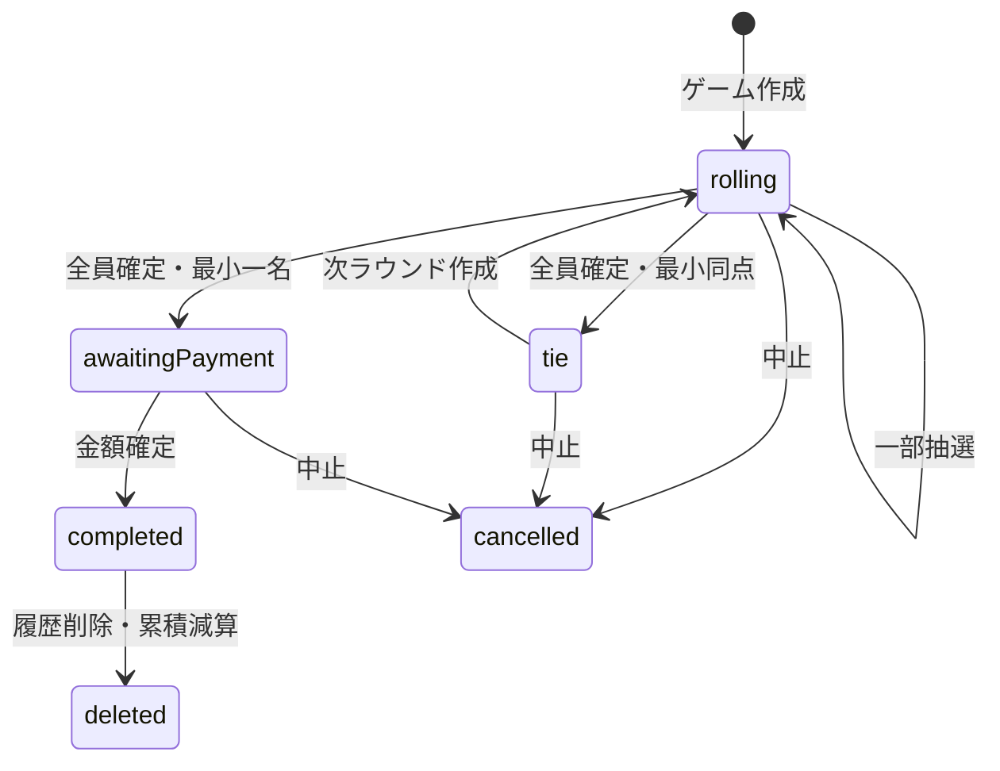

# サイコロは絶対 — 機能詳細

作成日：2026年10月14日

状態：バックエンド基本設計改訂稿。2026年10月14日の画面変更（履歴分離・負け額中心・F14履歴削除）を反映。未決定事項は設計提案として区別する。実装・実環境検証は未実施。

参照：[要件整理](../docs/requirements.md)／[画面一覧・機能一覧](../docs/screens-and-features.md)／[API定義](api-design.md)

DBは[DB設計](database-design.md)、認証構成は[インフラ](infrastructure.md)を参照。

## 前提と初期版の設計提案

管理者一人・一台の端末、固定参加者、バックエンド抽選、最小同点時の全員再抽選、整数円の所定計算、認証付き履歴は合意事項。DBはインフラ設計で合意済みのCosmos DB for NoSQL Serverlessを採用する。

履歴削除・削除額の累積からの除外は2026年10月14日の追加要件。以下の方式・範囲は未合意の提案で、要件を上書きする確定事項ではない。

| ID | 提案 | 理由・影響 |
|---|---|---|
| B01 | 参加人数2〜6人 | 原案に合わせる。画面確認で変更可能 |
| B02 | 一括操作は現ラウンドの未抽選者だけを振る | 個別済みの値を保持し混在操作に対応 |
| B03 | 同点結果を表示してから明示的に次ラウンドを作る | 同点確認と通信再送による連続抽選防止 |
| B04 | 未完了ゲームは管理者につき一件、再開または中止後に新規開始 | 二重開始・中断ゲームの取り違え防止 |
| B05 | ゲーム作成・各出目は即時保存。最終保存ボタンは金額確定 | 再読み込み後も抽選を復元 |
| B06 | 総額1〜9,999,999円。人数×1,000円未満も計算式どおり許可 | 0円は拒否。小額時の全額負担を画面で確認 |
| B07 | 保存後の金額訂正・中止取消は初期版対象外 | 履歴削除は追加要件としてF14で対応 |
| B08 | 累積額は削除されていない金額確定済みのみ、履歴はゲーム作成日時降順 | 未入力・中止・削除済みを除外 |
| B09 | 固定リストはDBに事前登録し、追加・改名は運用手順 | 管理UI・更新APIは作らない。最大100人を提案 |
| B10 | 完了履歴は論理削除。記録保持、初期版に復元APIなし | 履歴非表示と累積減算を原子的に実行。抽選記録は内部保持、全ラウンド閲覧APIは除外 |

## 状態モデル

| 状態 | 意味 | 許可操作 | 再開先 |
|---|---|---|---|
| `rolling` | 現ラウンドに未抽選者あり | 個別／未抽選者一括、中止 | S04 |
| `tie` | 全員確定、最小出目同点 | 全員の次ラウンド作成、中止 | S04 |
| `awaitingPayment` | 敗者一名確定、総額未確定 | 金額プレビュー・確定、中止 | S05 |
| `completed` | 金額確定済み | 参照・履歴削除 | S05／S06 |
| `cancelled` | 中止済み | 参照のみ | ホーム |
| `deleted` | 完了履歴を論理削除済み | 通常参照・更新不可、同じ成功キーの再生のみ | S06削除完了 |

作成後の参加者と順序は固定。ゲーム当時の名前を保存し、改名を過去ゲームへ反映しない。サーバーが所有者・日時・出目・敗者・計算結果を決める。ゲーム更新・出目・成功操作記録を同じトランザクションで保存する。

## 機能詳細

### F01 認証・利用制限

関連：全画面、A01・全API。SPAはMSALで既存テナントにログインし、API向けアクセストークンを取得する。APIは署名、期限、発行者、aud、tid、管理者oid、委任スコープ、許可SPAをインフラ設計第5節どおり検証する。固定参加者はログイン主体と別で、参加者IDは認証資格にならない。

A01で利用可否を確認してから業務画面を表示するが、各APIも認証を行う。401はトークン再取得後に同一要求を一度再送、再失敗ならS01へ。403は利用不可表示。認証失敗時はDBアクセスしない。

### F02 参加者選択

関連：S03、A02。有効な固定参加者を表示順で取得し、参加者IDを選択する。重複、存在しないID、無効者、人数範囲外を開始時にサーバーでも検証する。管理者自身も固定リストから選択。名前をHTMLとして解釈しない。

### F03 ゲーム開始

関連：S03、A03〜A05。入力は選択順の参加者IDと冪等性キー。固定リストから当時名と順序を複写し、ゲーム・全員未抽選の第1ラウンド・未完了ポインター・成功操作記録を同時作成する。固定リストの並行更新もETag条件で検出する。

作成後はS04。既存未完了がある場合は409で既存IDを返し、A04/A05で再開する。再送で別ゲームを作らない。再開にサーバーメモリーや端末に残った出目を使わない。

### F04 サイコロ抽選

関連：S04、A06。入力は現ラウンド番号と個別対象ID、または未抽選者一括指定。rollingのみ許可。個別対象は未抽選、一括は未抽選者が一人以上必要。

サーバーの暗号学的乱数API（C#では`RandomNumberGenerator.GetInt32(1, 7)`候補）で一人ごとに1〜6を一様生成する。剰余による偏りやクライアント乱数を使わない。出目・判定・ゲーム更新・成功操作記録をコミット後に返す。一部だけ成功しない。

個別済みの値を一括で上書きしない。別キーで抽選済み対象へ再要求は409。並行操作は一方のみ成功、他方は412または409。旧ラウンドへの要求も拒否する。

### F05 3D表示

関連：S04、A05/A06の結果を使用。フロントは応答の出目に上面を合わせてアニメーションする。乱数・物理演算から結果を再決定しない。送信・演出中は操作を抑制。再読み込みでは保存値の静止表示でよい。描画失敗時も名前と数値を表示し進行可能にする。描画専用APIは不要。

### F06 敗者判定・再抽選

関連：S04、A06/A07。未抽選者がいる間は判定しない。全員分がそろった更新内で最小値と該当者数を求め、一名ならawaitingPaymentとして敗者固定、複数ならtie。最小以外の同点（1・3・3）は振り直さない。

tieからA07で次ラウンドを作る。前の全出目・同点対象者を内部保持し、参加者全員を未抽選に戻す。A07自体は振らず、A06で新しい出目を確定する。敗者確定後の再抽選は禁止。同点回数にルール上の上限は置かず、ラウンドを別ドキュメントとして保存する。履歴画面では抽選記録を表示せず、全ラウンド閲覧APIは初期版から除外する。

### F07 会計総額入力

関連：S05、A08/A09。フロントでカンマ等を除去しても、API入力はJSON整数のtotalYenのみ。文字列、小数、指数表記、負数、0、上限超過は422、不正JSONは400。64ビット整数で演算する。敗者未確定・完了・中止では金額処理不可。

### F08 負担額・負け額計算

関連：S05、A08/A09。Nは保存参加人数、Tは検証済み総額。B=`(T / (N * 1000)) * 1000`（整数除算）、L=`T - B * N`。敗者以外B、敗者B+L、他者からの受取B×(N−1)。0≤L<N×1000、全負担合計=Tを検証。

A08は保存しない確認用計算。フロントの即時計算は補助表示。入力変更で古いプレビューを無効化する。A09で再計算し、クライアントの計算結果を保存しない。計算ルールバージョンを保存する。

### F09 結果保存

関連：S05、A09。総額・If-Match・冪等性キーを受け取り、awaitingPaymentからcompletedへ。会計、各自負担、負け額、確定日時を保存し、未完了ポインター解除・敗者の累積額へのL加算・成功操作記録を一つのトランザクションで行う。

通常履歴・集計には削除されていない金額確定済みのみを含む。保存後は金額固定（履歴削除はF14）。応答未受信なら同じキー・本文・If-Matchで再送し、別キーで再登録しない。保存応答に更新済み集計を含める。

### F10 履歴閲覧

関連：S06、A10/A15。ホームS02に履歴を載せず、入口からS06へ遷移する。一覧は削除されていないcompletedのみ、ゲーム作成日時降順、同日時はgameId降順。日時・当時の敗者名・負け額・会計総額・人数を返す。0円の負け額も履歴として表示する。

詳細A15は当時の参加者名、敗者、会計、各自負担、負け額、金額登録日時、削除可能フラグを返し、出目・抽選記録を含めない。A05はS04の再開とS05共有用に使う。未完了はA04、中止は通常一覧から除外。削除済みの取得は410で表示から取り除く。

UTC日時を画面でAsia/Tokyoに変換する。過去名はスナップショット。公開履歴・ログイン不要URLは作らない。

### F11 累積負け額表示

関連：S02、A12。参加者ID単位で削除されていないcompletedの敗者に記録されたLのみ累積。BやB+Lは加算しない。削除では保存済みのLを一回減算する。未参加・未敗北は0円。無効化した参加者も過去集計には残す。現在の固定リスト名を表示する。

読取時の全履歴走査を避け、保存トランザクションで集計ドキュメントを更新する。L=0でも完了として保存。正本は完了ゲームで、不整合時は更新を停止して再構築する。

### F12 共有用の結果表示

関連：S05、A05/A09。保存済み参加者・最終出目・敗者・各自負担・総額・負け額を表示。スクリーンショットとLINE等への送信は管理者操作。画像配布API・公開結果URLは作らない。画像保存・共有ボタンの採否は画面側で決める。

### F13 重複操作・通信失敗への対応

関連：S04/S05/S06、全更新API。操作前にキー・本文・対象・If-Matchを端末に一時保存し、成功確認まで同一要求を維持。認証トークンは操作記録に保存しない。DBの成功操作記録と更新を同時コミットし、サーバー再起動後も同じ結果を返せるようにする。削除の再送でも二重減算せず、削除後に保存応答を再生しても復活しない。

412では最新状態を取得し操作を見直す。新ETagへ差し替えて古い操作を自動実行しない。429/503/通信断は待機後に同一要求で再送。古い成功応答の再生で画面を巻き戻さない。読取セッションはAPI共通仕様に従いFunctionsインスタンス間でも継承する。

A13で未完了を中止し、出目を削除せずcancelledへ、未完了ポインター解除。金額確定との競合は同じゲームのETagで排他。入力途中の総額テキストはサーバー保存せず、再読み込み後は再入力を許容する。

### F14 履歴削除

関連：S06、A15/A14。個別詳細のETagと対象日時・敗者・負け額・総額を取得し、確認画面を表示。キャンセルは詳細へ戻り、APIを呼ばない。確認後にDELETEを送信する。対象はcompletedのみ、未完了の中止はA13。

サーバーで削除状態と累積減算・成功操作記録を同時保存する。減算は保存済みのLを使い、0円も削除可能。deletedAtとrevisionを更新し、当時名・会計・抽選記録は内部保持。別の未完了ゲームのポインターは変更しない。

成功後は削除完了を表示し、当該詳細・共有結果を端末キャッシュから除外。一覧のページ境界を破棄して先頭から再取得、ホーム累積も更新する。同キー再送は元の成功、別キーで既に削除済みは410、版不一致412、未完了・中止は409。減算で累積が負になる場合は全件未更新・503とし運用修復する。

保存・別履歴削除との並行処理はgameとlossTotalsのETagで検出し、二重加算・減算を防ぐ。保存後の金額訂正や復元は追加しない。論理削除・初期版に復元APIなしはB10の提案。

## 確認事項

設計提案B01〜B10の採否、固定リストの実メンバー、ローカルDB検証方式。履歴削除自体は要件として反映済み、論理削除・復元非提供の方式を確認対象とする。実名は公開成果物や設計文書に含めず構築時に設定する。画面側には再開・中止、明示的な再抽選、未保存／保存済みの区別を調整依頼する。

## 実装時の検証観点

| 対象 | ケース・期待値 |
|---|---|
| 入力 | 1人/7人/重複ID/無効者は拒否、2人/6人は作成可能 |
| 抽選 | 個別→一括で値保持、一括→個別は上書き拒否、出目1〜6 |
| 判定 | 1・3・3は一名敗者、1・1・6は全員再抽選、未抽選中は判定なし |
| 計算 | 13,800円/4人→B=3,000・L=1,800・敗者4,800・受取9,000 |
| 境界 | 4,000円/4人→L=0、3,999円/4人→B=0・L=3,999、0円拒否（提案） |
| 冪等性 | 同じ成功要求再送で同じ値、キーの本文相違は409 |
| 競合 | 個別同時・個別/一括同時・保存/中止同時に一方のみコミット |
| 永続化 | コミット前障害は全件未反映、コミット後応答断は再送で復元 |
| 集計 | 再送でも一回加算、未完了・中止は加算なし、改名でもID別合算 |
| 履歴 | S06一覧に当時敗者名・日時・負け額、詳細に出目なし、0円履歴も表示 |
| 削除 | 保存Lだけ一回減算、0円削除、最終一件削除で一覧空・該当累積0、同キー再送で再減算なし |
| 削除競合 | 二重削除・別履歴削除・新ゲーム保存との競合で正しい累積を保持、削除後の保存再送で復活なし |
| 認証・読取 | 別ユーザー拒否、認証失敗時DBアクセスなし、別インスタンスでもセッション継承 |
