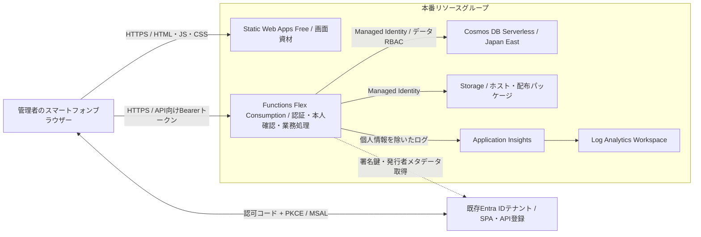

# サイコロは絶対 — Azureインフラ基本設計

作成日・公式資料確認日：2026年10月14日

状態：基本設計初稿。合意事項と設計提案を区別する。2026年10月15日に初回インフラ配置と主要設定の読み取り確認を実施。[確認記録](../infra/deployment-verification.md)を参照。

参照：[要件整理](../docs/requirements.md)／[画面・機能一覧](../docs/screens-and-features.md)／[API定義](api-design.md)

## 1. 合意事項

| 項目 | 方針 |
|---|---|
| 利用形態 | 管理者一人がログインしたスマートフォン一台で利用 |
| 認証 | 個人Microsoftアカウントを招待・登録済みの既存Entra IDテナントを使用。新しい顧客向けExternal IDテナントは作らない |
| 管理権限 | 管理者本人がAzureを管理し、アプリ登録を含む必要な管理権限を保有している（本人確認済み） |
| 環境 | Azure上は本番1環境、開発はローカル |
| 配置 | Japan Eastを基本とし、Azure既定ドメインを使用 |
| 費用 | 無料枠を優先し、全体で月額1,000円以内を目標。料金上限を保証するものではない |
| DB | Cosmos DB for NoSQL Serverless（従量課金）。Free Tierは前提にしない |
| 公開範囲 | HTML・JavaScript等の画面資材とログイン画面は公開配信。参加者名・履歴等のデータ取得とゲーム操作は管理者本人のみ |
| 現段階の範囲 | 設計文書・Bicep・Entra準備スクリプトの作成、アプリ登録、初回インフラ配置と主要設定の確認まで完了。アプリコード配置・業務動作確認は後続 |

以降のサービス選択・設定値・運用方法は設計提案。構築前の確認事項は第10節に記載する。

## 2. 構成方針

フロントエンドをAzure Static Web Apps（SWA）Freeで配信し、独立したAzure Functions Flex ConsumptionをAPIとして使用する。ブラウザーからAPIの別オリジンに直接通信する。

独立したFunction AppをSWAに関連付けて同一ドメインの`/api`として公開する機能はStandardが必要。この案では関連付けを行わず、SWA組み込み認証も使用せず、MSALで既存テナントへログインする。[SWAバックエンド連携](https://learn.microsoft.com/en-us/azure/static-web-apps/functions-bring-your-own)

FunctionsはLinux、Functions 4.x、C# .NET 10 Isolated Workerとする案。Flex Consumptionの対応スタックに.NET 10が掲載されている。実サブスクリプションでのリージョン利用可否・割当量とSDKの具体的なバージョンは構築前に確認する。[Flex Consumption](https://learn.microsoft.com/en-us/azure/azure-functions/flex-consumption-plan)

## 3. リソース構成図

Entraアプリ登録はリソースグループ外でテナント単位に管理する。API・DB・Storageは公開エンドポイントを使用する案で、ネットワーク閉域化は初期構成に含めない。

## 4. リソース一覧・設定案

名前は例示。`<suffix>`はグローバル一意性を確保する文字列で、実名は構築時に決定する。

| リソース | 名前例 | 設定案 |
|---|---|---|
| Resource Group | `rg-rollpay-prod-jpe` | Japan East、環境・用途タグ |
| Static Web Apps | `swa-rollpay-prod` | Free、既定HTTPSドメイン。リソース配置先は対応リージョンから選択 |
| Functionsプラン | `plan-rollpay-prod-jpe` | Flex Consumption、オンデマンド、Always readyは0 |
| Function App | `func-rollpay-prod-<suffix>` | Japan East、Linux、.NET 10 Isolated、4.x、システム割り当てManaged Identity |
| Storage Account | `strpprd<suffix>` | Japan East、StorageV2、Standard LRS、HTTPSのみ、TLS 1.2以上、匿名Blob公開禁止 |
| Cosmos DB Account | `cosmos-rollpay-prod-<suffix>` | NoSQL、Serverless、Japan East単一リージョン、Session整合性 |
| Cosmos DB Database | `rollpay` | コンテナー・パーティションはAPI／データ設計で決定 |
| Application Insights | `appi-rollpay-prod-jpe` | Workspaceベース、リクエスト・依存呼び出し・例外収集 |
| Log Analytics Workspace | `law-rollpay-prod-jpe` | Japan East。保持30日を初期案とし、課金条件を確認 |
| Entraアプリ登録 | `rollpay-spa-prod` / `rollpay-api-prod` | 既存テナントに2登録、Single tenant |

Functionsのメモリーは2,048 MBを初期案とし、起動・実行時間を計測して調整する。最大インスタンス数は構築時の許容最小値を確認して設定する。1人利用でも不正リクエストによる起動・費用増大の可能性は残る。

SWAの静的コンテンツはグローバル配信されるため、日本国内限定配信とは扱わない。業務データはJapan EastのDBに保存し、公開ビルド成果物には参加者名・履歴・秘密情報を含めない。

## 5. 認証・管理者の許可（F01）

### アプリ登録

- SPA登録はSingle tenant。MSAL.jsで認可コードフロー＋PKCEを使用し、クライアントシークレットは作成しない。
- Authorityは既存テナントを指定し、`common`や`consumers`は使用しない。
- 本番SWA URLとlocalhostの開発URLをSPA用リダイレクトURIとして個別登録する。ポート・パスは画面設計で決定。ワイルドカードは使用しない。
- API登録に委任スコープ`access_as_user`を定義し、SPAから要求する。APIアクセストークンはv2を採用する案。
- 管理者の対象テナント内ユーザーオブジェクトを確認する。個人Microsoftアカウントでも、そのディレクトリに登録されたゲスト等としてSingle tenantアプリを利用する。[アカウント対応範囲](https://learn.microsoft.com/en-us/entra/identity-platform/single-and-multi-tenant-apps)

### API検証

Isolated Workerの共通ミドルウェアで全業務APIを保護する案。MicrosoftのJWT検証ライブラリーを使用し、署名検証を独自実装しない。Easy Authとの二重運用は初期案に含めない。

| 項目 | 検証案 |
|---|---|
| 正当性 | テナントのメタデータ・署名鍵で署名、発行者、期限を検証。鍵更新に追従 |
| `aud` | API Client IDと一致（v2の場合） |
| `tid` | 既存テナントIDと一致 |
| `oid` | 対象テナント内の管理者ユーザーObject IDと一致 |
| `scp` | `access_as_user`を含む。アプリ単独トークンは許可しない |
| `azp` | 許可したSPA Client IDと一致 |

`tid`と`oid`を組み合わせて本人識別する。メールアドレス・表示名は許可判定に使わない。IDトークン、Graph向けトークン、クライアントが任意に送るユーザーIDもAPI利用資格としない。[クレーム検証](https://learn.microsoft.com/en-us/entra/identity-platform/claims-validation)

HTTPトリガーのFunctionsキー認証は`Anonymous`とし、Bearer認証は共通ミドルウェアで必須にする。業務APIの匿名利用を許可する設計ではない。全エンドポイントへの適用と、認証失敗時に業務処理・DBアクセスが実行されないことを実装時に検証する。

欠落・無効トークンは401、有効トークンで本人・スコープ等の権限条件を満たさない場合は403。CORSプリフライトのOPTIONSは業務処理を行わず応答する。

## 6. 通信・データアクセス

- ブラウザーはSWAのHTTPS URLからFunction Appの`https://<host>.azurewebsites.net/api/...`へ直接アクセスする。
- CORSの許可Originは本番SWAの完全一致1件。`*`、localhost、PRプレビューのOriginを本番APIに許可しない。
- `Authorization`、`Content-Type`、API設計で採用する冪等性ヘッダー等のプリフライトを許可する。Cookie認証は採用せず、CORSは認証の代替としない。
- APIからDBはManaged Identity接続。必要DBスコープにCosmos DB Built-in Data Contributor等のデータプレーン権限を付与する。通常のAzure Contributorだけではデータアクセス権限にならない。[Cosmos DB RBAC](https://learn.microsoft.com/azure/cosmos-db/nosql/how-to-connect-role-based-access-control)
- DB・コンテナー作成は配置用権限で行い、API実行時には作成しない。DBキー認証の無効化を提案する。
- ホストStorageと配布パッケージもManaged Identity接続とし、用途別の必要RBACを構築時に確認する。[Storage接続](https://learn.microsoft.com/azure/azure-functions/storage-considerations)、[Flex配置](https://learn.microsoft.com/en-us/azure/azure-functions/flex-consumption-how-to)
- DBへのネットワーク到達制限は初期案に含めず、Entra ID/RBACでデータアクセスを制御する。スマートフォンIPの許可リストは使わない。

## 7. 保存・可用性・復旧

抽選結果・金額・状態はCosmos DBを正本とし、Functionsのメモリー・ローカルファイルに依存しない。履歴の自動削除は行わない案。中断ゲームの保存期間・削除機能は機能設計で決める。

F13では冪等性キー、ETagによる競合制御、必要範囲で同一パーティション内のトランザクションをAPI設計で検討する。Functionsのインスタンス数制限を整合性保証としない。固定参加者名は保護されたAPI経由で取得する。

単一リージョンで、自動フェイルオーバーは構成しない。SWA FreeにはSLAがない。コールドスタート・配置時の一時停止を許容する案とし、アプリ全体の応答時間・稼働率保証値は設定しない。[SWAプラン](https://learn.microsoft.com/en-us/azure/static-web-apps/plans)

DBバックアップは継続的バックアップ7日保持を提案。7日枠のバックアップストレージは無償だが、復元・復元先には費用が発生し得る。別アカウントへの復元を基本とし、接続先・RBACを再設定して確認後に切り替える。[バックアップと復元](https://learn.microsoft.com/en-us/azure/cosmos-db/continuous-backup-restore-introduction)

復旧目標案はRPO 24時間以内・RTO 2日以内（許容データ損失24時間、復旧まで2日）。未合意の運用目標で保証ではない。Serverlessの対応条件・復元権限を構築前に確認し、初回構築時に復元手順を検証する。

## 8. 配置・設定管理・監視

### 配置案

- インフラは[Bicepテンプレート](../infra/main.bicep)で再現可能に管理する。Entraアプリ登録・同意・本人ID確認は別手順とし、実IDはパラメーターで受け取る。[テンプレートの使い方](../infra/README.md)を参照。2026年10月15日に初回デプロイ成功を確認。
- 単一GitリポジトリからSWAとFunctionsを別々に配置する。GitHub Actionsを候補とし、Functions／IaCのAzure接続はOIDCを優先する。
- SWA配置トークンが必要な方式ではGitHub Secretに保管。実リポジトリ・CI利用条件は構築前に確認する。
- 本番配置は手動実行を初期案とし、ローカル検証後にAPI、画面の順で配置。互換性を保ち、失敗時は直前の成果物を再配置する。
- PRプレビュー・画面モックは仮データを使用して本番APIに接続しない。ローカルAPI検証でも本番DBを既定接続先にせず、テスト用データを利用する。開発DBの具体的な方法は別途決定する。

### 設定案

| 配置先 | 設定 |
|---|---|
| フロントエンド公開設定 | Tenant ID、SPA Client ID、APIスコープ、API Base URL。公開識別子として扱う |
| Functions設定 | Tenant ID、API Client ID、許可SPA Client ID、許可管理者Object ID、Cosmos endpoint・DB名、監視接続設定 |
| Azureリソース設定 | Managed Identity、RBAC、Storage認証、CORS、HTTPS、バックアップ |
| CI秘密情報 | 必要なSWA配置トークン等。ソース・成果物・ログに出力しない |

長期DBキー・SPAシークレットを不要とする案なのでKey Vaultは初期構成に含めない。秘密が増えた場合に採用を見直す。

### 監視・運用案

リクエスト数、ステータス、処理時間、例外、DB依存呼び出し、RU消費・429等を確認する。Authorizationヘッダー、トークン、氏名、会計内容、要求・応答本文はログに記録しない。サンプリングと日次取込上限を設定し、上限到達時の監視欠落を運用手順に記録する。

月額予算1,000円に対し実績50%・80%・100%、予測超過を通知する案。予算通知は課金を停止しない。通知先とアラート料金は構築前に確認する。利用前後と月1回、失敗ログ・費用・容量を確認する。

## 9. 費用の見積もり方

円建て合計は未確定。契約・通貨・Japan Eastの単価を料金計算ツールで確認し、結果を追記する。

| 項目 | 見積もり条件 |
|---|---|
| SWA | Free上限内で運用 |
| Functions | 実行回数・GB秒、Always readyは0。無料付与の契約適用・他アプリの消費を確認 |
| Cosmos DB Serverless | 消費RU・保存容量等。Free Tierは適用されない |
| Storage | ホスト・配布パッケージの容量・操作回数 |
| 監視 | ログ取込・保持・アラート等 |
| その他 | 通信、復元、CI有料枠等 |

試算入力例は月100ゲーム×50 API呼び出し＋履歴等5,000呼び出し＝10,000 API呼び出し。平均実行1秒・2 GBなら20,000 GB秒。平均20 RU／APIなら200,000 RUに初期登録・集計等を加える。保存容量は0.1 GBと1 GBで比較する。すべて測定前の仮定で、同点再抽選・429再試行等を含む実測で更新する。

Flexの従量課金には対象契約で月250,000実行・100,000 GB秒の無料付与があるが、サブスクリプション内で共有される。Storage・監視・DBも無料になるという意味ではない。[Functions料金](https://learn.microsoft.com/azure/azure-functions/pricing)、[Cosmos DB料金](https://azure.microsoft.com/en-us/pricing/details/cosmos-db/serverless/)

## 10. 構築前の確認事項

| ID | 内容 | 設計への影響 |
|---|---|---|
| I01 | 管理権限は本人確認済み。構築時に既存テナントの対象ユーザーObject IDを確認し、ログイン・スコープ同意を検証 | 認証設定値と動作の確認。メールアドレス等を本文に記載する必要はない |
| I02 | Japan EastのFlex利用可否・割当量、.NET 10のSDK・配置ツール対応 | 対応不可なら構成を再検討 |
| I03 | 月額1,000円目標の円建て見積もりと無料付与の適用 | 見積もり・実測を反映 |
| I04 | 7日バックアップ、RPO 24時間・RTO 2日の運用目標案 | 保持・復旧方針を確定 |
| I05 | CI利用条件、通知先、CI用IDへの最小限のRBAC割り当て | 配置・費用監視手順を確定。本人の管理権限とCI用IDの権限は別に設定する |
| I06 | コンテナー・パーティション、冪等性、固定参加者登録方法、ローカル開発DB | API／機能設計で決定。公開ビルドに実名を含めない |

## 11. 他設計との接点・検証観点

- 画面：S01は公開ログイン画面、S02〜S06は認証・権限確認後にデータ表示。認証失敗時の遷移、API初回起動の待機表示を用意する。
- API：全業務APIにF01を適用し、本人・スコープ検証、CORS、401／403、F13の冪等性・競合制御を共通仕様にする。
- 機能：F02の参加者名は保護APIから取得。F03〜F11の状態・結果はバックエンド保存を正本とする。保存単位・中断時の扱いは別途決定。
- 構築時検証：本人ログイン、別ユーザー403、トークン欠落・期限切れ・別aud拒否、許可外Origin、OPTIONS、Managed Identity接続、ログへの個人情報混入防止、再配置・復元、費用実測を確認する。

本書の公式資料リンクは2026年10月14日の公開資料を参照したもの。実テナント・サブスクリプション内の主要設定は翌15日に確認。料金適用・アプリ動作・復旧等の未検証項目は確認記録に記載する。

## 12. Bicep初版の具体化

2026年10月14日、現在の構成でテンプレートを作成する依頼を受け、`infra`に初版を追加。DB設計の`app`コンテナー、`/ownerKey`、検索インデックス案を反映した。初期値はSWA配置先East Asia、Flex最大40インスタンス、Log Analytics取込上限50 MB/日、RG単位の予算通知。これらは未測定の設定案であり、構築前に契約・地域対応と費用を確認する。

認証ミドルウェア、CORSの応答ヘッダー公開、ログの個人情報除外・サンプリング、初期データ登録、コード配置、復元検証はテンプレートだけで完了せず、API実装・構築手順で対応する。翌15日にアプリ登録と実Azureリソースの配置、SWAのリダイレクトURI追加まで完了した。
